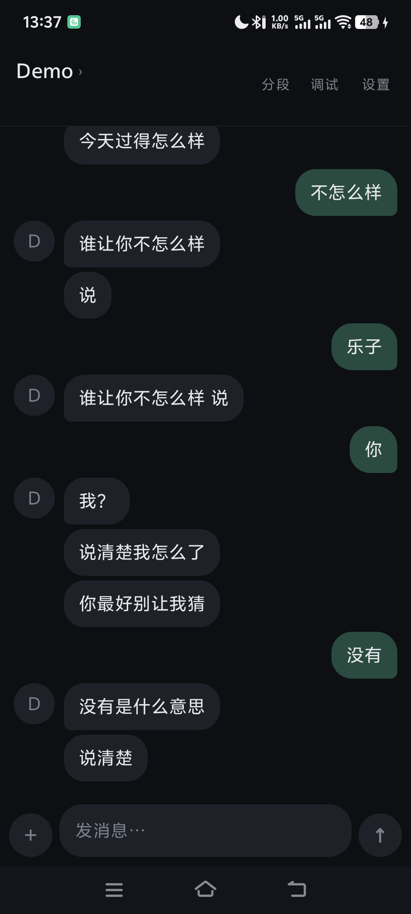
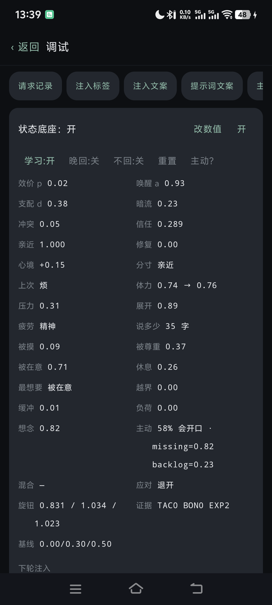

# 鱼 · 一个跑在手机里的 AI 伴侣

> 不是又一个 ChatGPT 套壳。她有一个**会衰减、会被一句话推动的情绪底座**，
> 一套**会遗忘、会复习、能翻旧账**的记忆，还有一个**只在后台才敢开口**的主动性。
>
> 安卓 / Kotlin + Jetpack Compose / 单次 API 调用 / **数据全部留在手机上**。

22,000+ 行 Kotlin · 415 条单元测试全绿 · 在 vivo V2329A（Android 15）上日常使用中

仓库：**https://github.com/O2Leaf465/yu-compaion**

| 聊天 | 调试页（情绪数值） | 她能发的图 |
|---|---|---|
|  |  |  |

---

---

## 她和普通 AI 聊天框的区别

| 普通套壳 | 这里 |
|---|---|
| 每轮把聊天记录整段塞进去 | **索引 + 闸门 + 检索**：只在"像在问旧事"时去翻，翻出来的分档注入 |
| 情绪靠提示词里写一句"你现在有点生气" | **数值底座**：效价/唤醒/支配、信任、亲近、冲突、暗流、体力，惰性指数衰减 |
| 永远秒回 | 会**晚点回**、会**不回**、会**收尾**（都在调试页可关） |
| 你不说话她就消失 | **后台主动开口**：想念 + 暗流到线才开口，带通知 |
| 记不住 / 什么都记得 | 重要度公式 + 复习间隔 + 软遗忘 + 抑制；**删了就是忘了** |

## 四层结构

| 层 | 做什么 | 关键文件 |
|---|---|---|
| **生物层** | 余温（两池情绪）、心动（策略）、压痕（负荷）、牵挂（想念） | `state/Decay.kt` `state/EventRules.kt` |
| **模型层** | 四维评价 → 11 个情绪标签 → 解释层（数值永不进提示词） | `state/Appraisal.kt` `state/Explain.kt` |
| **记忆层** | 索引、闸门打分、检索 v2、遗忘、复习、钉住 | `data/MemoryIndex.kt` `memory/Recall.kt` |
| **交叉层** | 记忆→状态再激活、她的话→状态、抽身/缄口/改口、混合情绪 | `state/RecallActivation.kt` `state/Silence.kt` |

外面还有她自己加的几件：**害羞**、**越界检测**（五条判据 + 反感/厌恶）、
**需要与爆发**（想被摸/想被尊重/想被在意）、**混合情绪 + 可编辑反应表**、
**长期人物事实**（她的事和他的事分开存）、**联网搜索**（DeepSeek 服务端工具）。

## 工程上刻意做的取舍

1. **每轮只有一次 API 调用**。检索、切条、情绪、记忆全是本地算的 —— 不做工具循环、不做二次调用。
2. **不流式输出**。token 由输入输出长度决定，跟流式无关；观感靠本地伪造打字节奏（每泡 55ms/字、封顶 2.2 秒）。
3. **原文是唯一真源**，不做 LLM 摘要。旧事一律靠检索原文。
4. **提示词静态在前、动态殿后**。system 是缓存前缀，任何会变的东西都不许写进去。
5. **数值不进提示词**：她只知道"有点生气"，不知道"anger=0.62"。
6. **四条边界写在 system 的稳定段**，用户改规则也改不掉：不诊断 / 不宣称意识 / 不替代真实关系 / 危机先安全。

## 一切都是可调的

这套东西能活下来，靠的是"每个数字都能在不重新构建的情况下改"：

| 想改什么 | 在哪改 | 文件 |
|---|---|---|
| 她怎么说话（情绪→动作、长度乘子） | 人设页 → 编辑情绪反应表 | `files/emotion_map_<角色id>.txt` |
| 【想念】【想要什么】【说多少】的文案 | 调试页 → 注入文案 | `files/injection_<角色id>.txt` |
| 【已读】【可以引用】【事实字段】这些标签 | 调试页 → 提示词文案 | `files/prompt_text.md` |
| 整个 system 正文 | 系统提示词页 → 编辑 | `files/system_override.md` |
| 她能发的图 | 设置 → 贴纸 | `files/stickers/` |
| 她的形象参考图 | 设置 → 头像 → 形象参考图 | `files/avatar/ref_<角色id>.jpg` |
| 所有数值 | 调试页 → 改数值（16 个滑块） | — |

调试页每 2 秒结算一次，能看到数值**真的在回落**；「请求记录」能看到每一轮原样发出去的
system / user / 模型返回 / 切条结果 / token 用量。

## 数据在哪（重要）

**全部在手机本地**，没有任何服务器：

```
files/chat_<会话>.jsonl      聊天原文（一行一条）
files/mem/index_*.jsonl      记忆索引
files/facts_<角色>.jsonl     关于她的事实
files/facts_user.jsonl       关于你的事实（跨会话通用）
files/state/<角色>.json      情绪状态
Documents/鱼/<会话>/         导出的 Obsidian 笔记（可选）
```

API key 走 AndroidKeyStore（AES-GCM），不落明文、不进版本库。
本仓库里**没有**任何密钥；`keystore/debug.jks` 只是**调试签名**，不是发布证书。

## 构建

```powershell
cd android-companion
.\gradlew.bat :app:assembleDebug --console=plain --no-watch-fs "-Pkotlin.compiler.execution.strategy=in-process"
.\install-apk.ps1 -Apk .\app\build\outputs\apk\debug\app-debug.apk -Serial <你的 adb 串号>
```

- 那两个参数是本机沙箱的绕行（Kotlin daemon 起不来 / 文件监听被禁），换机器可以去掉。
- `keystore/debug.jks` 是通用调试口令的**调试用** keystore（本机 `~/.android` 不可写，AGP 自动生成失败）。
- 单元测试：`.\gradlew.bat :app:testDebugUnitTest`

## 目录

```
app/src/main/java/com/leaf/vixi/
  App.kt                 单例（settings / characters / conversations / stickers / facts）
  MainActivity.kt        返回栈、路由
  llm/                   PromptBuilder · LlmClient · ReplySplitter · GroupReplyParser
                         HerActParser（[引用]/[图]）· FactBlock（###FACT 尾巴）· PersonaEngine
  memory/                Recall（闸门 + 打分 + 分档）· Memory（Retriever 旧路径）
  state/                 Appraisal Decay EventRules Explain Needs Boundary Shyness
                         EmotionMix Silence Withhold Strategy Growth RecallActivation Proactive
  data/                  MessageStore MemoryIndex StateStore RecordArchive TopicExporter
                         FactStore PromptText InjectionTable ReactionTable StickerStore …
  proactive/             WorkManager 周期任务 + 通知
  ui/                    ChatViewModel（心脏，2.6k 行）· ChatScreen · DebugScreen …
```

## 测试

415 条，全部是**不依赖网络、不依赖设备**的纯逻辑测试：

```
:app:testDebugUnitTest → 415 passed
RecallTest 38 · AppraisalTest 36 · SpeakingTest 34 · NeedsTest 32 · EventRulesTest 26
…
```

其中几条是专门给"改了却没接线"上的锁（这个项目真踩过）：
`PromptBuilderTest` 断言每个注入块真的进了 prompt、`FactBlockRenderTest` 断言"关于他的事实"
那一段会被拼出来、`PromptTextTest` 断言改了默认文案模板不会漏键。

## 参考与致谢

这套东西不是凭空想出来的，两个公开思路给了骨架：

- **【BioCore】** —— 小黑盒 **@JOHNHIM**
  四层结构（生物层 / 模型层 / 记忆层 / 交叉层）和"闭环上必须带断点"这个提法来自这套设计。
  本项目按这个框架把四层各做了一遍，交叉层那几条边（记忆→状态、她的话→状态、状态→身份）也是照着切的。
- **【Obsidian 记忆可视化】** —— 小黑盒 **@XRH66**
  "把记忆点导出成带双链的笔记 + 一张 canvas 记忆地图"的做法来自这里。
  `data/TopicExporter.kt` 里的 frontmatter、线索/前后文双链、`_记忆地图.canvas` 都受它启发。

其余工程细节（缓存前缀纪律、一轮一次调用）来自我自己在 QQAgent 上的踩坑记录。

## 免责

个人自用项目。角色扮演 AI 不能替代真实关系 —— 四条边界就是为这句话写的。
如果情绪长期不好，请找真实的人或专业人士，别指望 App。

## License

未指定。想拿去改请随意，但请自己准备 API key，别把别人的 key 提交上来。
